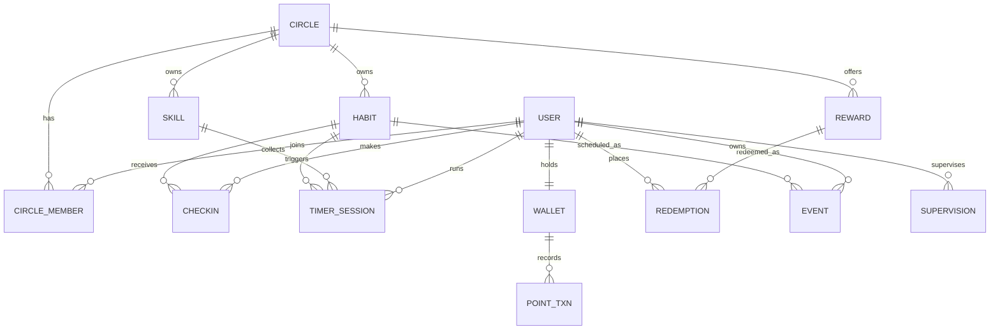
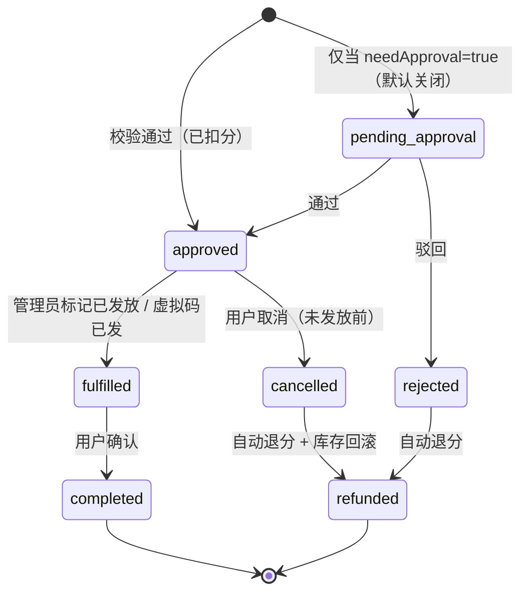

# 习惯成长与积分奖励系统 · 软件需求文档（PRD/SRS）

| 项 | 内容 |
| --- | --- |
| 文档版本 | v0.3（决策已定稿，进入设计与开发） |
| 日期 | 2026-10-20 |
| 项目代号 | `checkin-system`（产品名待定） |
| 形态 | Web 应用（响应式 + PWA，手机/电脑浏览器可用，可装到桌面） |
| 使用范围 | 邀请制小圈子，**当前 2 人**，上限 20 |
| 文档状态 | **主体已定稿**：第 13 章 8 项决策已确认，只剩 2 个开放问题 |
| 配套文档 | [`竞品调研.md`](./竞品调研.md)（互联网同类产品的功能与坑） |

---

## 0. 阅读指南

- **第 1–4 章**：为什么做、给谁做、数据长什么样。看不懂技术字段可以跳过。
- **第 5 章**：功能需求主体，每条都有编号 `FR-xx` 和优先级（P0 = 首个版本必须有，P1 = 第二阶段，P2 = 以后再说）。
- **第 11 章**：验收标准。你说「验收就是这些」我就按这个开发。
- **第 13 章**：需要你做的决定。**其它章节都只是我的建议，这一章才是需要你输入的**。

> 优先级口径：P0 = 缺了系统就不成立；P1 = 明显提升体验、第二阶段做；P2 = 锦上添花，可能永远不做。

---

## 1. 背景与目标

### 1.1 要解决的问题

你目前的状态大概是：**想做很多事，但缺少一个"闭环"**——打卡记录散落在不同 App、专注计时在另一个 App、时间花在哪又靠回忆、奖励自己全凭心情。具体三个痛点：

1. **动力断档**：打卡本身没有即时反馈，坚持 3 天就断了；「努力 → 回报」之间没有可见的兑换关系。
2. **数据割裂**：习惯打卡、专注时长、时间分配是三套数据，无法回答"我这个月在练琴上花了多少小时、习惯完成率多少"。
3. **监督缺位**：一个人自律很难，多个朋友互相盯，但现有工具要么没有监督机制，要么监督就是"看一眼"，没有约束力。

### 1.2 产品目标

一句话：**把"努力"变成一种可积累、可消费、可被看见的资产。**

三层目标：

| 层次 | 目标 | 衡量方式 |
| --- | --- | --- |
| 行为层 | 让每天的打卡/专注动作足够轻（≤2 次点击） | 单次打卡耗时、日活打卡率 |
| 动机层 | 让积分与奖励形成稳定循环 | 周人均获得积分、兑换转化率、平均连续天数 |
| 认知层 | 让时间去向可解释 | 技能卡片覆盖的计时占比、周复盘打开率 |

### 1.3 明确不做（非目标，防止范围膨胀）

- ❌ 公开注册的社交社区、动态 feed、陌生人匹配、内容审核体系
- ❌ 真钱充值、押金契约金（stickK 那种扣钱机制）——涉及支付与合规，v1 不碰
- ❌ 完整 IM / 语音房 / 视频自习
- ❌ 排行榜攀比（默认关闭，只保留"和自己比"）
- ❌ 多端原生 App（先 PWA，能装到桌面就行）
- ❌ AI 教练 / 自动生成计划（可放到很远期的想象里）

### 1.4 成功标准（1 个月后回看）

- 你和另一个人连续使用 ≥ 4 周，没有中途放弃
- 每人每周打卡 ≥ 10 次，**至少完成一次兑换（含一次两人合兑）**
- 你不再需要打开第二个 App 记时间

---

## 2. 产品定位

### 2.1 定位陈述

> 给**小圈子**（家庭 / 学习搭子 / 自律小组）用的**成长激励系统**：用「习惯打卡 + 专注计时 + 技能统计」记录努力，用「积分 + 奖品兑换」兑现努力。

### 2.2 核心循环

```
        ┌──────────────────────────────────────────────┐
        │                                              │
   ① 设定 ──► ② 执行 ──► ③ 记录 ──► ④ 积分 ──► ⑤ 兑换 ──┘
   习惯/技能   打卡/计时    自动入账    账本累计    奖品/奖励
        ▲                                              │
        └──────────── ⑥ 复盘（统计告诉我下一步调什么）◄──┘
```

- ① **设定**：建习惯、建技能卡片、上架奖品（把"想要的"提前放进去，形成牵引）
- ② **执行**：点一下打卡，或开一个计时
- ③ **记录**：自动生成打卡记录 / 计时记录，归到技能
- ④ **积分**：按你自定义的规则入账，流水可查
- ⑤ **兑换**：积分换奖品（一个人换，或者两个人凑分换）
- ⑥ **复盘**：热力图、技能时长、周报，反过来调 ①

### 2.3 与现有产品的差异（借鉴什么、舍弃什么）

| 参照产品 | 借鉴 | 舍弃 / 我们的不同 |
| --- | --- | --- |
| Habitica | 打卡即奖励、连击（streak）、组队互相看见 | 不做 RPG 战斗/宠物，不做惩罚掉血（负反馈太重，小圈子容易劝退） |
| Forest / Focus To-Do | 专注完成才给奖励、中途放弃有代价、共同专注 | 不做"种树"视觉隐喻；放弃不清零，只不给积分 |
| Toggl / Clockify | 计时 → 项目归类 → 报表，时间线视图 | 不做计费/客户/发票；把"项目"简化为「技能卡片」 |
| 滴答清单 TickTick | 习惯 + 番茄 + 日历一体化 | 不做完整任务管理（GTD），日程只做轻量 |
| My Rules / 攢攢 | 积分 → 自定义奖励（真实奖励） | 增加多人、监督、审核、库存与限兑等"体系化"能力 |
| stickK / Beeminder | 承诺机制、监督人 referee | 不做真钱押金，用**积分扣减 + 社交可见**替代 |

**关键取舍**：同类产品要么只做"记录"（无激励），要么只做"激励"（无数据）。我们的价值是**把计时数据当成积分来源**——不是打卡才有分，认真专注 45 分钟同样有分，而且这段时间会被记进技能卡片。这解决了"打卡容易造假、计时才是真投入"的问题。

---

## 3. 用户与角色

### 3.1 角色定义

| 角色 | 说明 | 典型人 |
| --- | --- | --- |
| 游客 | 未登录，只能看登录页 | — |
| 成员 Member | 圈子的普通成员：打卡、计时、兑换 | 你自己、朋友、孩子 |
| 监督人 Supervisor | 被指派去盯某些成员/某些习惯的人，可确认/驳回/催办 | 学习搭子、家长 |
| 圈子管理员 Admin | 圈子的所有者：管理奖品、审核兑换、调积分、管成员 | 你（或家长） |
| 系统管理员 | 部署者，管数据库/备份，不参与业务 | 你（技术身份） |

**重要**：一个人可以同时是成员 + 监督人 + 管理员。**「自己给自己发奖励」是合法场景**——此时管理员和成员是同一个人，兑换可以配置为自动通过。

### 3.2 权限矩阵

| 能力 | 成员 | 监督人 | 管理员 |
| --- | :---: | :---: | :---: |
| 创建/编辑自己的习惯 | ✅ | ✅ | ✅ |
| 看自己的全部数据 | ✅ | ✅ | ✅ |
| 看他人的打卡（仅共享/被监督范围内） | 仅共享 | ✅ 被监督对象 | ✅ 圈子内 |
| 打卡、计时、兑换 | ✅ | ✅ | ✅ |
| 确认 / 驳回他人打卡 | ❌ | ✅ | ✅ |
| 催办（提醒对方打卡） | ❌ | ✅ | ✅ |
| 上架 / 编辑 / 归档奖品 | ❌ | ❌ | ✅ |
| 标记已发放 / 退款 / 手动调分 | ❌ | ❌ | ✅ |
| 手动加/扣他人积分（需理由） | ❌ | ❌ | ✅ |
| 邀请/移除成员、设置监督关系 | ❌ | ❌ | ✅ |

### 3.3 三类典型用户（用来校验功能是否够用）

**A. 自律型个人（你自己）**——一个人就是一个圈子。
> 早上打开首页，看到今日 5 个习惯。点掉"早起""喝水"，弹 +15 积分。晚上开 45 分钟倒计时练吉他，结束自动记入「吉他」技能卡 +20 分。月底看到「吉他 12.5 小时 / 打卡完成率 87%」，用 800 分换了那张一直想买的专辑。

**B. 学习搭子（2–5 人）**
> 三个人建了个圈子"考研上岸"。每天晚上 20:00 一起开 90 分钟共同倒计时，谁中途退出房间会显示"已离开"。谁连续 3 天没打卡，监督人可以选择"催一下"，对方手机上弹出提醒。

**C. 家长与孩子**
> 家长是管理员，孩子是成员。习惯"练琴 30 分钟"配 10 分、"整理房间"配 5 分，可以要求**拍照留证**（不强制审核，家长看到就行）。奖品区有"周末多玩 1 小时游戏""挑一本书"。孩子兑换后**积分立即扣掉、订单立即成立**，家长收到"有东西要准备"的通知，东西给了再点"已发放"。

> 这三类人共用同一套机制，区别只在**配置**（谁审核、要不要证明、奖品是什么）。这是本系统的设计主轴：**机制固定，规则可配**。

---

## 4. 核心概念与数据模型

### 4.1 名词表（后文统一用这些词）

| 名词 | 英文/字段前缀 | 含义 |
| --- | --- | --- |
| 圈子 | Circle | 一个封闭的使用单元（家庭/小组），积分、奖品、成员都在圈子内 |
| 习惯 | Habit | 一件要重复做的事，带频率和积分规则 |
| 打卡记录 | Checkin | 某人在某天完成了某个习惯的一条记录 |
| 计量 | Quantity | 计量型习惯的单次数量（如"喝水 3 杯"） |
| 积分账户 | Wallet | 每人在每个圈子一个余额 |
| 积分流水 | PointTxn | 只增不改的账本，余额由流水推导/对账 |
| 奖品 | Reward | 可用积分兑换的东西，可含图片、库存、限兑 |
| 兑换单 | Redemption | 一次兑换行为，有完整状态机 |
| 计时会话 | TimerSession | 一次计时（正计时/倒计时/番茄） |
| 技能卡片 | Skill | 时间归集的容器，累计时长 + 等级 |
| 日程事件 | Event | 日历上的一件事，可关联习惯/技能 |
| 监督关系 | Supervision | 谁监督谁，作用于哪些习惯 |

### 4.2 实体关系



### 4.3 关键字段定义

#### 用户 User
| 字段 | 类型 | 说明 |
| --- | --- | --- |
| id | uuid | |
| nickname | string(20) | 昵称 |
| avatar | url | 头像 |
| email/username | string | 登录标识（二选一或都支持） |
| passwordHash | string | Argon2/bcrypt |
| timezone | string | 默认 Asia/Shanghai |
| dayCutoffHour | int(0-6) | **日切时间**，默认 0。设为 4 表示凌晨 4 点前算前一天（夜猫子友好） |
| weekStart | int | 0=周日 / 1=周一，默认 1 |

#### 圈子 Circle
| 字段 | 类型 | 说明 |
| --- | --- | --- |
| id / name / avatar | | |
| ownerId | user | 管理员 |
| inviteCode | string | 邀请码，可重置 |
| joinPolicy | enum | `invite_only`（默认）/ `code`（有码即可加入） |
| settings | json | 见 5.1.4 圈子级配置 |

#### 习惯 Habit
| 字段 | 类型 | 说明 |
| --- | --- | --- |
| id / circleId / ownerId | | |
| title | string(40) | |
| icon / color | | |
| type | enum | `check`（普通打卡）/ `quantity`（计量）/ `negative`（戒断/负向）/ `timed`（计时达标） |
| frequency | json | 频率规则，见下 |
| unit | string | 计量单位：杯/页/公里/次 |
| targetPerPeriod | int | 每周期目标次数，默认 1 |
| goalType | enum | `at_least`（至少完成，默认）/ `at_most`（至多，用于"少喝咖啡"这类） |
| countInStats | bool | 是否计入完成率，默认 true（有些习惯只想记个流水） |
| pointsPerCheckin | int | 单次打卡得分，可 0 |
| pointsPerUnit | int | 计量型每单位得分 |
| dailyCap | int/null | 单日最多得多少分（防刷） |
| proofRequired | enum | `none` / `note` / `image` |
| checkinWindow | json/null | 允许打卡时段，如 06:00–10:00，null = 全天 |
| allowBackfill | int | 可补打卡天数，0 = 不允许，默认 0 |
| backfillPointsRatio | float | 补打卡积分系数，默认 0 |
| autoCheckinOnTimer | bool | 计时达标自动打卡（timed 型） |
| defaultSkillId | skill/null | 计时型习惯默认归入的技能 |
| linkedHabitId | habit/null | 负向习惯的配对（做 A 就视为 B 失败） |
| visibility | enum | `private` / `circle` |
| status | enum | `active` / `paused` / `archived` |
| sortOrder | int | |

**频率 `frequency` 结构**（借鉴 Loop Habit / TickTick）：
```json
// 每天
{ "kind": "daily" }
// 每周指定几天
{ "kind": "weekdays", "days": [1,3,5] }
// 每周 N 次（不限哪天）
{ "kind": "perWeek", "times": 3 }
// 每 N 天一次（N ≤ 60，再大就不叫习惯了）
{ "kind": "interval", "every": 2, "anchor": "2026-10-01" }
// 每月 N 次 / 每月指定日
{ "kind": "monthly", "times": 4 }
```
**频率决定"今天要做几次"** `dueToday`：daily→1；weekdays→今天在 days 里则 1；perWeek→本周剩余需要次数（不强制具体哪天）；interval→按 anchor 推算。

#### 打卡记录 Checkin
| 字段 | 类型 | 说明 |
| --- | --- | --- |
| id / habitId / userId | | |
| date | date | **逻辑日期**（已按 dayCutoffHour 处理） |
| checkedAt | timestamptz | 真实时间 |
| quantity | int | 计量型数量，默认 1 |
| note / images | text / json | 备注、证明图 |
| mood | enum/null | 可选：😀 🙂 😐 😣 |
| status | enum | `pending` / `approved` / `rejected` |（仅需审核时出现 pending） |
| reviewedBy / reviewedAt / rejectReason | | |
| source | enum | `manual` / `timer` / `backfill` / `admin` |
| pointsAwarded | int | 本条实际发分（快照，规则改了不影响历史） |
| txnId | 关联积分流水 | |

**约束**：同一 `(habitId, userId, date)` 通常只允许一条 → 用 `countPerDay` 允许同日多次（如"喝水"3 杯记 3 条或 1 条 quantity=3）。

#### 积分账户 Wallet / 流水 PointTxn
```ts
Wallet { userId, circleId, balance, totalEarned, totalSpent, frozen }
PointTxn {
  id, walletId, type,      // earn_checkin | earn_timer | earn_bonus | earn_manual
                            // spend_redeem | refund | adjust | expire
  delta: number,            // 正=入账 负=出账
  balanceAfter: number,     // 便于对账与展示
  refType, refId,           // 关联 checkin / timer / redemption
  reason: string,           // 手动调整必填
  operatorId, createdAt,
  reversedByTxnId | null    // 冲正关系
}
```
**原则**：流水 append-only，**永不修改、永不删除**。改余额必须新增一条冲正流水。

#### 奖品 Reward
| 字段 | 类型 | 说明 |
| --- | --- | --- |
| id / circleId / createdBy | | |
| title | string(40) | |
| description | text(500) | 描述/规则说明 |
| images | json[] | 1–5 张，第一张为封面 |
| pointsCost | int | 兑换所需积分 |
| stock | int/null | null = 无限 |
| limitPerUser | int | 每人最多兑换次数，默认 1 |
| cooldownDays | int | 两次兑换间隔天数，默认 0 |
| needApproval | bool | 是否需要管理员审核 |
| fulfillmentType | enum | `virtual`（虚拟，即时/发码）/ `physical`（实物）/ `offline`（线下自提/特权） |
| category | string | 分类：奖励/特权/体验/实物 |
| tags | json | |
| visibility | enum | `circle` / `admin_only` |
| status | enum | `draft` / `active` / `paused` / `soldout` / `archived` |
| sortWeight | int | 置顶/排序 |
| validFrom / validTo | timestamptz/null | 上架时间窗 |

#### 兑换单 Redemption
| 字段 | 类型 | 说明 |
| --- | --- | --- |
| id / rewardId / userId | | |
| snapshot | json | **下单时快照**：title / pointsCost / image / fulfillmentType / description |
| pointsCost | int | 实际扣的分（来自快照） |
| status | enum | 见 5.4.3 状态机 |
| note | text | 用户备注（如"想要草莓味"） |
| reviewNote / reviewedBy / reviewedAt | | 审核信息 |
| fulfillmentInfo | json | 兑换码 / 快递单号 / 领取时间 |
| refundTxnId | | 退款流水 |

#### 计时会话 TimerSession
| 字段 | 类型 | 说明 |
| --- | --- | --- |
| id / userId / circleId | | |
| mode | enum | `stopwatch`（正计时）/ `countdown`（倒计时）/ `pomodoro`（番茄） |
| plannedSeconds | int/null | 倒计时目标 |
| elapsedSeconds | int | 服务端计算的净计时（不含暂停） |
| status | enum | `running` / `paused` / `completed` / `abandoned` |
| startedAt / endedAt / lastHeartbeatAt | timestamptz | 防篡改的时间锚点 |
| pausedTotalSeconds | int | |
| skillId / habitId | | 归集与联动 |
| roomId | | 多人房间（可空） |
| pointsAwarded | int | |
| note | text | |

#### 技能卡片 Skill
| 字段 | 类型 | 说明 |
| --- | --- | --- |
| id / circleId / ownerId | | |
| name / icon / color | | |
| description | text | |
| targetHours | int/null | 长期目标，如 1000 小时 |
| levels | json | `[{level:1, hours:0}, {level:2, hours:10}, ...]` |
| totalSeconds | int | 冗余累计值（由计时记录汇总，可重算） |
| status | enum | `active` / `archived` |

#### 日程条目 Entry（事件与待办共用）
| 字段 | 类型 | 说明 |
| --- | --- | --- |
| id / userId / circleId | | |
| kind | enum | `event`（占一段时间）/ `task`（待办，可完成） |
| title / note | | |
| startAt / endAt / allDay / timezone | | 按 UTC 存 + 记录时区 |
| rrule / exdates / recurrenceId | | 存 RRULE 字符串（方便将来导出 .ics），v1 只生成 L0 规则 |
| reminders | json | `[0, 10, 60]` 分钟前；全天事件用"当天 09:00"语义 |
| category / color | | |
| linkedHabitId / linkedSkillId | | 一键打卡 / 一键计时 |
| estimateMin | int/null | 预估时长，用于「计划 vs 实际」 |
| actualMin | int | 实际时长（由计时累加） |
| completedAt / cancelledAt | | `kind=task` 时使用 |
| version | int | 乐观锁，防止多端覆盖 |
| status | enum | `planned` / `done` / `cancelled` |

#### 计时会话 TimerSession（补充字段）
| 字段 | 类型 | 说明 |
| --- | --- | --- |
| deviceId / revision | | 多端接管与乐观锁 |
| overtimeSeconds | int | 超时继续的秒数（仅普通倒计时） |
| breakSeconds | int | 番茄休息段（不计入专注） |
| strictness | enum | `loose` / `standard` / `strict`，放弃结算用 |
| pausedByClient | bool | 断线时以服务端为准 |
| verified | bool | 是否通过防刷校验（异常会话不进榜） |

---

## 5. 功能需求

> 标注约定：`[P0]` 必须有 · `[P1]` 第二阶段 · `[P2]` 可选  
> 每条需求的验收口径见第 11 章。

### 5.1 账号与圈子

**FR-A1 [P0] 注册与登录**
- 邮箱/用户名 + 密码注册；密码 ≥ 8 位。
- 登录态保持 30 天（HttpOnly Cookie 或 JWT）。
- 支持"记住我"、退出登录、修改密码。
- 不做：手机验证码、第三方登录（P2）。

**FR-A2 [P0] 创建 / 加入圈子**
- 新用户注册后引导创建第一个圈子（填写圈子名、头像），创建者即管理员。
- 管理员生成 6 位邀请码或邀请链接 `/join/{code}`；可重置邀请码。
- 加入方式：`仅邀请`（需管理员批准）/ `凭码加入`（有码直接进）。
- 成员上限默认 20（当前只有 2 人，留余量给以后加人）；不做多圈子切换。

**FR-A3 [P0] 成员管理**
- 管理员可：查看成员列表、设置/取消监督人、移除成员、转让管理员。
- 成员可：主动退出圈子（其历史数据保留在圈子内，标记为"已退出"）。
- 移除成员时，其积分余额与历史流水保留（归档为只读）。

**FR-A4 [P1] 圈子级配置（`settings`）**
| 配置项 | 默认值 | 说明 |
| --- | --- | --- |
| `timezone` | Asia/Shanghai | 圈子统一时区（v1 不做跨时区） |
| `dayCutoffHour` | 0 | 日切时间 |
| `weekStart` | 1 | 周一 |
| `allowBackfillDays` | 0 | 全局补打卡上限（与习惯级取小值） |
| `defaultNeedApproval` | false | 新奖品默认是否需审核 |
| `dailyEarnCap` | null | 每人不日获取上限（防通胀） |
| `showLeaderboard` | false | 是否显示圈子排行榜 |
| `selfRedemptionAutoApprove` | true | 管理员兑换自己上架的奖品时是否自动通过 |

---

### 5.2 习惯与打卡

**FR-B1 [P0] 创建 / 编辑习惯**
- 字段见 4.3；必填：名称、频率、积分值。
- 提供模板快选（早起 / 喝水 / 阅读 / 运动 / 背单词 / 练琴 / 早睡），一键创建后仍可改。
- 支持排序（拖拽）、分组/标签（P1）、暂停（`paused`，不计入完成率）、归档。

**FR-B2 [P0] 今日清单**
- 首页按"今天该做的"展示：`dueToday` 排序（未完成在前）、显示连续天数、今日已得积分。
- 支持"全部打卡"批量操作（仅对 `proofRequired=none` 的习惯）。
- 完成后有即时反馈：+N 积分动画、连击数更新（**必须轻，不能有弹窗打断**）。

**FR-B3 [P0] 打卡交互**
- 点一下即打卡（默认数量 1）；计量型点开输入数量（步进器 + 快捷 +1）。
- 打卡后可补充：备注、图片（最多 3 张）、心情（可选）。
- **撤销**：当日 24:00 前可撤销（或 5 分钟内，见 FR-B4 规则），撤销后生成负向流水冲正。
- **同日多次**：若 `countPerDay > 1`，每次打卡生成一条记录并累加计量。
- **打卡时间窗**：若设置了窗口，窗口外打卡提示"不在打卡时段"，但仍允许（记录标记 `out_of_window`，是否给分由规则决定，默认给）。
- **重复打卡防护**：已达标的情况下再点，提示"今天已完成"，需二次确认才追加。

**FR-B4 [P1] 补打卡（backfill）**
- 允许补最近 N 天（N 由习惯与圈子配置取小值，默认 0 = 关闭）；即使开启，**窗口最多 T+2**（只能补昨天、前天）。
- 补打卡的积分系数默认 0（不给分），可配置 0 / 0.5 / 1。
- 补打卡必须在记录上留痕（`source=backfill`），统计报表中可单独区分，且**不计入"全勤"**。
- **限制**：单个习惯每月补打卡次数上限（默认 3 次），防止"月末突击"作弊。

**FR-B5 [P0] 连续天数（streak）**
- 定义：按习惯频率，连续满足"该做且做了"的周期数。daily 口径 = 连续自然日（按 `dayCutoffHour` 切分）。
- 中断规则：某天 `dueToday` 但未完成 → streak 归零；`paused` 期间不中断也不累计。
- 展示：当前连续、最长连续、断点日期。
- **不做"连击冻结/补签"**（P2 再考虑，Habitica/Duolingo 那种保护卡容易让机制失真）。

**FR-B6 [P0] 多人打卡（共享习惯）**
- 习惯可选 `collaborative`：一个习惯，多人共同参与。
- 参与方式：管理员/创建者邀请成员加入，或成员自主加入（圈子内可见）。
- 每人各自打卡，互不影响；但提供**团队视图**：今日谁打了/谁没打、团队完成率。
- 团队加成（P1）：全员当日达成 → 每人额外 +N 分（可配）。
- **互看边界**：只展示"是否完成/连续天数/总积分"，不展示备注与图片（除非对方设为公开）。

**FR-B7 [P0] 监督打卡**
三种模式（习惯级配置）：
| 模式 | 说明 | 生效时机 |
| --- | --- | --- |
| `self` 自证 | 默认。打卡立即生效、立即得分 | 即时 |
| `witness` 见证 | 打卡后进入 `pending`，监督人确认后生效；超时（默认 72h）自动通过 | 审核后 |
| `proof` 举证 | 必须上传图片/备注才可提交，监督人审核 | 审核后 |

- **监督关系**：管理员指定"监督人 A 监督成员 B 的哪些习惯"，可多条。
- **待审核队列**：监督人首页显示"待我确认 (3)"；支持批量通过。
- **驳回**：必须填理由（预设选项 + 自由文本），驳回后不扣分、不计入完成，成员收到通知。
- **催办**：监督人可对未打卡成员发"催一下"（每天每人对同一习惯最多 1 次，避免骚扰），成员收到推送 + 站内消息。
- **监督可见性**：监督人可看被监督者的打卡记录、备注与图片（因为审核需要）。
- 积分发放时机：**审核通过时才发分**（pending 期间显示"待入账"）。

**FR-B8 [P0] 负向习惯（戒断类）**（你已确认要做）
- 例："不刷短视频 2 小时"、"不喝奶茶"。
- 完成定义是"当天没做坏事"：需要在日终自动结算（默认次日 0:30 结算，或用户主动"今天守住了"）。
- **注意**：这类习惯本质是 `goalType=at_most`（Loop 的 "至多" 型），**不能用"完成了"来判定**——必须显式记录"破戒"入口，否则无法区分"没记录"和"守住了"。
- 得分：守住 +N；破戒 → 扣 N（走 `adjust` 流水，负数）；连续守住有额外奖励。
- 关联习惯：正向习惯 A 完成会"抵消"负向习惯 B 的破戒（如"运动了就可以喝奶茶"）。

---

### 5.3 积分体系

**FR-C1 [P0] 积分来源**
| 来源 | 触发 | 默认值 | 可配 |
| --- | --- | --- | --- |
| 习惯打卡 | 打卡生效（或审核通过） | 习惯上设的 `pointsPerCheckin` | ✅ 每习惯 |
| 计量加成 | 数量 × `pointsPerUnit` | 0 | ✅ |
| 计时完成 | 计时达标结束 | 见 FR-E6 | ✅ |
| 连续里程碑 | 连续 7 / 30 / 100 天 | 20 / 100 / 500 | ✅ 圈子级 |
| 团队加成 | 全员达成 | 10 | ✅ 圈子级 |
| 技能里程碑 | 技能累计达阈值 | 50 | ✅ 每技能 |
| 管理员手动 | 手动加/扣 | — | ✅ 必填理由 |

**FR-C2 [P0] 自定义规则（关键需求）**
- 每个习惯独立设置积分值 → 满足"积分多少可自定义"。
- 圈子级设置：连续里程碑分数、每日获取上限、是否允许手动调整。
- **规则变更不追溯**：改规则只影响之后的记录；历史记录保留当时的 `pointsAwarded` 快照。
- **防刷**：
  - 单习惯单日封顶 `dailyCap`（默认不设，但提供开关）
  - 每日总获取上限 `dailyEarnCap`（超过部分记 0 并在流水标注 `capped`）
  - 打卡时间窗口 + 补打卡限制 + 审核机制
  - 计时单次上限（默认 6 小时）、单日累计上限（默认 10 小时），超时不计分

**FR-C3 [P0] 积分账户与流水**
- 每个成员在圈子里有一个余额，首页常驻显示。
- 流水分页倒序、按类型筛选（获得/消耗/调整），每条显示关联对象（哪次打卡/哪张兑换单）。
- **账本字段**：`id, walletId, type, delta, balanceBefore, balanceAfter, refType, refId, reason, operatorId, idempotencyKey, reversalOf, createdAt`。
- **只追加**：退款/撤销用**反向分录**（`reversalOf` 指向原流水），**永不 UPDATE 或 DELETE** 已有流水。`balanceBefore/After` 用于对账时定位"从哪条开始错的"。
- **幂等**：打卡、兑换、退款都带 `idempotencyKey`，网络重试不会重复入账。
- 余额校验：`balance == sum(delta)`，管理端提供"对账"按钮，不一致则报警。
- 并发安全：扣分用事务 + 行锁（`SELECT ... FOR UPDATE`）或条件更新（`UPDATE ... WHERE balance >= ?`），**不允许负余额**。

**FR-C4 [P1] 积分过期**
- 默认不过期（小圈子场景，过期容易引发"白干"的挫败感）。
- 提供开关：N 个月未活动则清零（默认关闭）。

**FR-C5 [P0] 积分规则说明页**
- 一个页面把"怎么得分/怎么花分/上限是多少"用人话写清楚，避免成员搞不懂规则。
- 支持管理员编辑一段「圈子公约」富文本。

---

### 5.4 奖品与兑换

**FR-D1 [P0] 创建 / 编辑奖品**
- 必填：标题、积分价（≥1）、履约类型；可选：描述、图片（1–5 张）、库存、每人限兑、冷却期、分类、有效期。
- **图片上传**：支持 jpg/png/webp，单张 ≤ 5MB，服务端压缩到 1280px 长边、转 WebP；可拖拽排序、设封面、删除；上传失败可重试。
- 预览：编辑时实时预览"成员看到的卡片长什么样"。
- 草稿（`draft`）不展示给成员；发布后 `active`。

**FR-D2 [P0] 奖品列表（商城）**
- 卡片：封面图、标题、积分价、剩余库存、限兑标记。
- 分区：可兑换 / 积分不足（显示"还差 N 分"）/ 已售罄 / 已兑换过。
- 排序：默认（管理员权重）→ 积分价升/降 → 最新。
- 筛选：分类、只看我能换的。
- 空状态引导："还没有奖品，去上架一个"（管理员看到"去创建"）。
- **定价完全由你（管理员）设定**，系统不给建议价、不做汇率换算——积分值多少，你说了算。

**FR-D3 [P0] 兑换流程（默认不审核）**
1. 点"兑换" → 确认弹窗：奖品快照、扣多少分、兑换后余额、限兑剩余次数、履约方式。
2. 校验（服务端，事务内）：
   - 奖品 `status=active` 且在有效期内
   - 库存 > 0（若限库存）
   - 用户未超 `limitPerUser`
   - 冷却期已过
   - 余额 ≥ 积分价
3. **在同一个数据库事务里**完成：扣分（写流水 `spend_redeem`）→ 库存 -1 → 创建兑换单（状态直接 `approved`）。任何一步失败则整体回滚。
   - **不需要审核**：分数够就成立，这正是你要的"分数合规就行"。
   - 虚拟奖品立即发码 → `fulfilled`；实物/线下奖品进入"待发放"，等管理员标记。
   - **幂等**：请求带 `idempotencyKey`，连点两次只会生成一张单。
4. 通知管理员"有新的兑换"（不是"待审核"，是"待发放"）。
5. 管理员标记已发放 → `fulfilled` → 用户确认 → `completed`。

> 保留 `needApproval` 字段但**默认关闭**：将来若要"大额兑换需要确认"，打开开关即可，不改结构。

**FR-D4 [P0] 兑换单状态机**



| 状态 | 含义 | 可执行动作 | 积分 |
| --- | --- | --- | --- |
| `approved` | 已成立，待履约 | 标记已发放 / 用户取消 | 已扣 |
| `fulfilled` | 已履约（已发码/已交付） | 用户确认 | 已扣 |
| `completed` | 完成 | — | 已扣 |
| `cancelled` | 已取消（未发放前） | — | 已退 |
| `refunded` | 已退款（终态） | — | 已退 |
| `pending_approval` / `rejected` | **默认不启用**，仅 `needApproval=true` 时出现 | — | — |

**规则**：
- 退款时库存 +1；流水新增一条**反向分录**（`refund`，`reversalOf` 指向原扣分流水）。
- 已 `fulfilled` 的实物单**不能自动退分**，只能管理员手动 `adjust` 并填写理由（防止"拿了东西又退款"）。
- 所有状态变更写操作日志（谁、何时、从什么状态到什么状态）。
- 合兑订单退款时**按每人出资比例分别退回**（见 FR-D10）。

**FR-D5 [P0] 重复兑换控制（你特别提到的点）**
| 场景 | 规则 |
| --- | --- |
| 同一奖品换多次 | **总限兑** `limitPerUser`（默认 1；虚拟奖品如"看一集剧"可设 999） |
| 每月都能换一次 | **周期限兑**（P1）：`limitPerPeriod = 每月 N 次`，用于"每月一杯奶茶"这类 |
| 冷却期 | `cooldownDays` 内不可再兑换 |
| 名额占用 | 取消/驳回时**释放**名额，已发放**不释放**；占额与扣分同事务 |
| 库存共享 | 所有人共享 `stock`，先到先得；库存 0 自动 `soldout` |
| 并发 | 事务内 `UPDATE stock = stock - 1 WHERE stock > 0`，影响行数 0 则失败并提示"手慢了"；**禁止先查后改** |
| 连点 | 前端置灰 + 服务端 `idempotencyKey` 去重 |
| 已归档奖品 | 不可兑换，详情页显示"已下架" |
| 想让某奖品只给某人 | 用 `visibility=admin_only` + 口头约定（v1 简化为不展示给他人；P2 做定向可见） |

**FR-D6 [P0] 兑换记录（我的订单）**
- 列表：状态、时间、积分、履约信息；按状态筛选。
- 详情：奖品快照、当前状态、时间线（下单 → 发放 → 确认）、操作按钮（取消/确认）；合兑单额外显示每个出资人出了多少分。
- 管理员视图：全部订单，按状态/成员/奖品筛选，批量"标记已发放"，导出 CSV。

**FR-D7 [P0] 奖品管理（后台）**
- 列表：搜索、状态筛选、库存预警（≤3 显示黄标）。
- 操作：编辑、上下架、调库存、归档、复制（快速创建相似奖品）。
- **归档（archive）**：`status=archived`；从商城消失；不可新兑换；**历史兑换单完整保留**；后台可查看/恢复。
- **删除**：仅当该奖品**没有任何兑换记录**时允许硬删除；否则只提供归档（防数据孤儿）。

**FR-D8 [P1] 虚拟奖品兑换码**
- 管理员可批量导入兑换码池（一行一个），兑换时自动发放一个并标记已用。
- 无码时降级为"管理员手动发放"。

**FR-D9 [P1] 通胀看板（管理端）**
- 四个数：**总发放 / 总消耗 / 当前结余 / 人均结余**，加一个"本周消耗率"。
- 编辑奖品时提示"当前圈子结余 X 分，这个奖品已兑换 Y 次"，帮助判断"发的分是不是比能换的多"。
- 健康区间（参考电商会员体系，小圈子只需大致判断）：消耗率 45%–65%，结余不要长期单向上涨。
- 不做设备指纹、IP 风控、延迟到账这类反黑产手段——几个人的圈子是强信任环境，真风险是"规则没定清楚"，不是刷分产业链。

**FR-D10 [P0] 合兑：多人一起凑分换一个奖品**

> 你明确要的："允许**多个人一起凑分**换东西。"这不是"团购"，而是**一张订单、多个付款人**。

**建模（关键简化）**
- 兑换单的出资人从 1 个变成 1..N 个：新增 `redemption_participants(userId, points, joinedAt, releasedAt)`。
- **单人兑换就是 N=1 的特例**，不新增第二套流程，所有校验/状态机/退款逻辑复用。

**流程**
1. **发起**：在奖品详情点"一起兑换" → 填「我出多少分」（可全出，也可只出一部分）→ 选邀请对象 → 设有效期（默认 24 小时）→ 生成"合兑单"（状态 `open`）。
2. **参与**：对方收到邀请 → 看到"还差 N 分" → 填自己出的份额 → 确认后**立即扣分**并占住份额。
3. **凑齐**：累计出资 ≥ 奖品价 → 自动成立（`approved`）→ 库存占用转为正式订单 → 通知所有出资人。
4. **凑不齐**：到期未满 → 自动解散（`expired`）→ **每个出资人的分原路退回**、库存归还。
5. **退出**：成立前可随时退出（`released`），退分并释放份额。
6. **领取人**：默认发起人，成立前可改；实物奖品的领取/收货以此人为准。
7. **履约与确认**：与普通兑换一致，只有领取人能点"确认完成"。

**规则与边界**
| 场景 | 规则 |
| --- | --- |
| 我比你多出一些 | 份额自由填，只要合计 ≥ 奖品价；超出部分不退（或者设"按比例封顶"，默认不封顶但提示） |
| 两人同时认领最后一份 | 条件更新 `UPDATE ... WHERE raised + ? <= target`，失败方提示"刚被凑满了" |
| 合兑的限兑次数算谁的 | 按**发起人**计；参与者不受 `limitPerUser` 限制，但也不能靠合兑刷次数 |
| 合兑期间奖品被单人买走 | 发起时即**预占库存**，所以不会发生；解散时归还 |
| 合兑订单退款 | 按出资比例分别退回；已履约则只能管理员手动调整 |
| 我能同时发起多个合兑吗 | 可以，但同一奖品只能有一个进行中的合兑（P1 再放宽） |
| 对方没积分 | 邀请页直接显示"他只能出 X 分"，避免发了也没用 |

---

### 5.5 计时器

**FR-E1 [P0] 三种计时模式**
| 模式 | 说明 | 结束条件 |
| --- | --- | --- |
| 正计时 `stopwatch` | 从 0 往上，用于"我也不知道要多久" | 手动结束 |
| 倒计时 `countdown` | 设定目标（如 25 min / 45 min / 90 min），到点响铃 | 到达目标（可配置继续超时） |
| 番茄 `pomodoro` | 专注 25 + 休息 5，每 4 轮长休 15 | 按轮次 |

- 预设时长：5 / 15 / 25 / 45 / 60 / 90 分钟 + 自定义（1–360 分钟，1 分钟粒度）。
- 番茄参数可配：专注段 / 短休 / 长休 / 长休间隔（1–8 段，默认 4）。
- **休息不计入专注时长、不发积分**（全行业共识）；统计里 work / break 分列，防止用休息刷时长。
- **超时规则**：番茄模式到点即停（时间盒的意义）；**只有普通倒计时**可开启"最低目标"——到点庆祝后继续正计时，显示 `+X:XX` 并变色，适合"至少写 30 分钟、但想一直写下去"。
- 结束提示音可选（工作结束 / 休息结束 / 整轮完成用不同音效，更好分辨）、可静音、可震动。
- 全屏专注视图：大号数字、环形进度、当前技能名、暂停/结束按钮。

**FR-E2 [P0] 计时控制与状态机**
```
idle ──start──► running ──pause──► paused ──resume──► running
                  │                    │
                  ├──finish──► completed（达标）
                  └──abandon──► abandoned（放弃）
```
- **暂停**：累计 `pausedTotalSeconds`，不计入 `elapsedSeconds`。
- **结束 vs 完成**：倒计时到点 = `completed`；正计时手动结束 = `completed`（只要有有效时长）；中途点"放弃" = `abandoned`。
- **放弃的严格度分三档**（圈子级设默认，单次会话可临时覆盖——"要不要逼自己"因人而异）：
  | 档位 | 记录时长 | 积分 | 连续专注天数 | 适合谁 |
  | --- | --- | --- | --- | --- |
  | 宽松 | ✅ 全额计入 | ⭕ 按时长比例 | ✅ 算 | 怕挫败的新手 |
  | **标准（默认）** | ✅ 全额计入 | ❌ 不给 | ❌ 不算 | 大多数人 |
  | 严格 | ⚠️ 只记 50% | ❌ 不给 | ❌ 不算，且断连击 | 需要强约束时 |
- **每周 1 张"补救卡"**（P1）：可把一次放弃的会话恢复为有效（借鉴 Duolingo 连续冻结，但限量，防止机制失真）。
- **最短有效时长**：默认 60 秒。低于 60 秒的会话直接丢弃（避免误点产生垃圾数据）。
- **暂停超 30 分钟**：弹窗三选一「继续 / 放弃 / 按已有时长结算」，防止"忘了停"导致 8 小时的假数据（这是番茄ToDo 评论区最常见的抱怨）。
- **空闲检测（P1）**：无操作 N 分钟（默认 5）标记空闲，回来后询问「算 / 丢弃 / 接着算」。桌面端按页面无交互判定，移动端按切后台判定。

**FR-E3 [P0] 可靠性（这是最容易出 bug 的地方）**
- **服务端权威时间**：`startedAt`、`pausedTotalSeconds`、`lastHeartbeatAt` 由服务端记录。前端每 30 秒心跳一次，服务端用 `now - startedAt - pausedTotal` 计算。
- 关闭页面/切后台：会话不结束；重新打开时按服务端时间续算（显示"你有一个进行中的计时：已 12:34"，可继续或结束）。
- 多标签页/多设备：同一用户**只允许一个进行中的会话**；在第二处开始时会提示"已在另一处计时"，只能选择「结束旧的并开始新的」（接管），不能双开累加。
- **防篡改**：不接受前端上报的 elapsed；修改系统时间无效。服务端校验 `endedAt ≤ now + 允许偏差(≤60s)`。
- **会话重叠检测**：服务端拒绝与已有会话时间重叠的新记录（这是 Forest 抓刷榜的方式，也是自建系统最容易被钻的洞）。
- 断网：前端本地继续显示，恢复网络后以服务端为准（差值 > 5 分钟时以服务端为准并提示）。提交失败时本地排队、带 `session_id` 幂等重传，避免重复计入。
- 崩溃恢复：`running` 超过 24h 未心跳的会话，自动结算为 `abandoned` 并记实际时长（封顶 24h）。

**FR-E4 [P0] 计时与技能/习惯的关联**
- 开始计时时可选：技能卡片（1 个）、关联习惯（1 个，仅 `timed` 型）、标签（多个，P1）、备注。
- 结束后：
  - 时长计入技能 `totalSeconds`
  - 若关联了 `timed` 型习惯且 `autoCheckinOnTimer=true` 且时长 ≥ 习惯阈值 → **自动创建打卡记录**（`source=timer`），按习惯规则给分
  - **避免双重计分**：`creditPolicy` 三选一（默认 `habit_only`）
    | 策略 | 打卡分 | 计时分 |
    | --- | --- | --- |
    | `habit_only`（默认） | ✅ | ❌ |
    | `timer_only` | ❌ | ✅ |
    | `both` | ✅ | ✅（需谨慎，容易通胀） |
- 未关联技能时：记入"未分类"，可在结束后补选（**事后归集**，P0，因为很多人开始计时时不想选）。

**FR-E5 [P0] 计时记录**
- 列表：时间倒序，显示时长、技能、备注、状态（完成/放弃）、是否得积分。
- 支持：编辑技能/备注、手动补录（`manual`）、删除（仅当日、且未得分的记录）、「再来一次」（复制上下文）。
- **时间线视图（P1）**：一天 24 小时的时间条，直观看碎片；**空档可一键补成记录**（比多一张图表更能提升记录完整率）。
- 拆分记录用"结束当前 + 新建"，不在一条记录上切分（避免统计口径混乱）。

**FR-E6 [P0] 计时完成得积分（规则由你自己填）**

> 你明确要的："**由我自己来设置计时多久给多少分**。"所以系统**不预置任何数值、不给建议价**，只提供规则编辑器。

三种计分方式，任选其一（技能级 / 全局默认）：

| 方式 | 你填什么 | 适合 |
| --- | --- | --- |
| **阶梯表（默认推荐）** | 若干档「时长 → 分值」，取**满足的最高档**。例：`25 分钟 = 10 分`、`45 分钟 = 20 分`、`90 分钟 = 45 分` | 番茄/固定时长的场景，心智最简单 |
| **按分钟** | 「X 分钟 = 1 分」，可加单次上限 | 想做长时间、时长不固定 |
| **按次** | 达标即给固定分，与时长无关 | 只关心"有没有做" |

- 规则可绑在**技能卡片**上（如"吉他"的计分和"跑步"不同），也可设一个全局默认。
- **达标门槛**：低于 N 分钟不给分（你自己设，默认 1 分钟）。
- **番茄模式**：只有"专注段"给分，休息段不给（可配）。
- **上限**：单次上限、单日上限都**可选**（默认不限）。开了能防"忘了停"导致的虚高数据，UI 上会提示这一点，但不强制。
- 规则变更**只影响之后的计时**，历史记录里存的是当时算出的分值快照。

**FR-E7 [P1] 多人共同倒计时（自习室）**

> 调研发现共同自习有三种同步模型，成本和体感差异很大，必须先选型。我们**两种都做，用房间设置切换**：
> - **弱同步（默认）**：各自开各自的计时，房间只共享"在场 + 状态 + 今日时长"。实现简单、不怕作息差异、断线无感。
> - **强同步（房间开关，叫"统一起止"）**：房主开始后所有人共用一套起止时间，到点一起响。

**房间**
- 创建：设时长、轮次、是否"统一起止"、是否允许中途加入；生成 6 位房间码 + 分享链接。
- 成员列表实时显示：头像、昵称、状态（准备中 / 专注中 / 已休息 / 已离开）、**已进行时长**（用 `now - startedAt` 实时算，不等结束才更新——这是番茄ToDo 自习室最大的槽点）。
- 上限 50 人；房主可移出成员、转让房主、解散房间。

**弱同步模式（默认）**
- 加入后自己点开始即可，不强制同时；房间页显示"今天这个房间累计专注 N 小时"的榜。
- 成员中途加入/退出都无惩罚，已产生的时长保留。

**强同步模式（开关）**
- 全员"准备"→ 房主开始 → 服务端广播 `{startAt, endAt}`（服务器时间）。
- 前端用「服务器时间 + 本地时钟偏移」校正，保证各端偏差 < 1s。
- 中途加入：从当前轮剩余时间开始（不重开一轮）。
- 房主退出：房间挂起并提示转移房主（不静默结束别人的计时）。

**共同规则**
- 房主可设"严格度"（对应 FR-E2 的放弃档位），统一房间内的口径。
- 房间内互动：v1 只做 6 个预设"加油"表情 + 完成时击掌动画，**不做聊天**。
- 结束后：每人各自的会话照常入库（计入技能与积分），房间页生成"本房间战绩"。
- **不做**：语音、视频、屏幕共享、公开房间发现、陌生人匹配（StudyTogether 那套社交压力对自用场景是负资产）。
- 榜单必须防刷：单账号单活跃会话 + 心跳 + 服务端重算，异常会话标"待核验"且不进榜。

**FR-E8 [P2] 白名单/防打扰**
- 桌面端"专注模式"提示（浏览器无法真正屏蔽其他 App，仅做页面级沉浸）。
- 移动端 PWA 无法屏蔽 App，需在需求中明确告知，不承诺该能力。

---

### 5.6 技能卡片

**FR-F1 [P0] 创建技能卡片**
- 字段：名称、图标（预置 emoji/图标集）、颜色、描述、目标总时长（可选）。
- 初始赠送等级体系：Lv1 = 0h，Lv2 = 10h，Lv3 = 30h，Lv4 = 60h，Lv5 = 100h，之后每 +100h 一级（可自定义阈值）。

**FR-F2 [P0] 时间归集**
- 主要来源：计时会话（结束时可选择/自动带出）。
- 次要来源：手动补录（时长 + 日期 + 备注）。
- 一个计时会话归属 **1 个主技能**；支持多标签（P1）。
- **事后归集**：未分类的计时可以在"待归类"列表里批量归入技能（P0，非常重要——没人愿意每次开始前选技能）。
- 编辑/删除计时记录时，技能累计值同步重算（不做增量加减，直接重算，避免漂移）。

**FR-F3 [P0] 技能详情与统计**
- 头部：图标、名称、等级、累计时长、距下一级还差多少。
- 图表：
  - 近 30 天柱状图（每日时长）
  - 热力图（年度，类似 GitHub 贡献图）
  - 占比环图（本技能 vs 全部技能）
- 列表：最近计时记录、关联习惯、目标完成度进度条。
- 支持归档（`archived`）：不再出现在计时选择器，但历史统计保留。

**FR-F4 [P1] 技能里程碑**
- 达到阈值（10h / 50h / 100h …）自动发放积分奖励 + 站内祝贺。
- 里程碑可自定义（技能级或全局）。

**FR-F5 [P1] 技能与积分的关系**
- 建议做法：技能本身不"给分"，**计时才给分**，技能只是统计容器。避免"刷技能等级"变成刷分手段。
- 里程碑奖励作为例外，配额有限（每个技能每级只发一次）。

---

### 5.7 日程表（轻量版）

> 定位：**日程表是"打卡与计时的容器"，不是第二增长曲线**。第一屏永远是打卡，日程回答的问题是"今天打算什么时候做"。

**FR-G1 [P0] 统一条目模型**
- 事件（有时间占用）和待办（有完成状态）**共用一张表 + `kind` 字段**，不做两套日历两套提醒。
- 字段：标题、备注、开始/结束、全天、`kind`（event / task）、完成状态、预估时长、实际时长、重复、提醒、颜色分类、关联习惯/技能。
- 快速创建：首页"+"→ 输标题 + 选时间，5 秒内完成（记录成本是这类功能最大的杀手）。

**FR-G2 [P0] 视图**
- **今日议程（主入口）**：时间轴（6:00–24:00），事件块 + 计划块 + 已完成的计时混排；当前时间红线，自动滚到"现在"。
- **本周视图**：7 列，点击展开详情。
- 月视图（P1，仅做概览下钻，不做精细编辑）。
- 移动端不用拖拽改期（窄屏误触高），改"长按 → 改期"。

**FR-G3 [P0] 习惯进日历 = 柔性时间窗，不是硬事件**
- 习惯在日历上显示为**时间窗柔性块**：「07:00–09:00 之间完成 30 分钟」，而不是「07:00 必须开始」。
- 理由：硬事件错过就挫败，柔性块允许"今天晚点做"，符合习惯养成的本质（这是 Loop/TickTick 与 Reclaim 的共识）。
- 错过时间窗**不惩罚**，只在"今日议程"里沉到底部并标灰。
- 与日程冲突时**提示不阻断**：标黄 + 建议顺延，不禁止保存。

**FR-G4 [P1] 重复与提醒**
- 重复（L0 够用）：每天 / 每周（选星期几）/ 工作日 / 每月同日 / 每 N 天；结束条件（永不 / 某日 / 共 N 次）。
- 例外：**跳过这一次** / **只改这一次** / **改此后全部**（用户最需要的是前两个，第三个 P2）。
- 提醒：给三档（准时 / 提前 10 分钟 / 提前 1 小时）+ 自定义，**不要甩一个 0–10080 分钟的输入框**。
- 全天事件没开始时刻 → 提醒挂"当天 09:00"，并支持"前一天 20:00"（最常被漏的选项）。
- 错过提醒：本地通知在关机/免打扰/切时区时不可靠 → 下次打开时给一条"错过汇总"。

**FR-G5 [P0] 与其它模块联动（这是日程表存在的理由）**
- 块可填**预估时长**；计时结束落**实际时长**；周报给"计划兑现率"和"最常超时的类别"。
- 从块一键开始计时（带出技能、标题、预估时长）；结束后问一句"完成了吗"（默认"询问"，不自动勾选，避免误伤多段计时的大任务）。
- 回写必须带幂等键（`entryId + version`），否则会出现"重复任务被加进日历"这类幽灵条目。

**FR-G6 [P0] 边界**
- 不做：多人共享日历、CalDAV/双向同步、AI 自动排程（Motion 那种"计划一直被挪"的体验与打卡产品的稳定感相斥）。
- 只读 ICS 订阅（P2）：把 Google/Outlook 的会议拉进来做冲突提示，**只读不写回**——成本低、收益高，避开双向同步的冲突地狱。
- 导出 .ics（P2）。

---

### 5.8 统计与回顾

**FR-H1 [P0] 个人主页**
- 今日：完成 x/y、今日积分、当前连续。
- 本周：打卡完成率、总专注时长、新增积分。
- 年视图热力图（所有习惯合并 + 可按习惯筛选）。

**FR-H2 [P1] 圈子周报**
- 每周一 09:00 生成：本周全员打卡数、最活跃成员、团队完成率、积分发放/消耗、库存预警。
- 展示形式：站内页面 + 可选推送。
- **不做群内攀比排名**（除非管理员开启排行榜）。

**FR-H3 [P1] 数据导出**
- 导出 CSV：打卡记录、计时记录、积分流水、兑换记录。
- 导出 JSON：全量备份（管理员）。
- **必须做**：自建系统最怕数据丢失，备份是硬需求（见 8.4）。

**FR-H4 [P2] 洞察**
- "你周三最容易漏打卡"、"练琴时长环比 +32%"这类文字洞察。
- v1 不做，先把基础图表做好。

---

### 5.9 通知与提醒

**FR-I1 [P0] 通知类型**
| 类型 | 触发 | 默认渠道 |
| --- | --- | --- |
| 习惯提醒 | 到设定时间 | 推送 |
| 错过提醒 | 当日 21:00 仍未打卡 | 推送 |
| 监督催办 | 监督人点击"催一下" | 推送 |
| 待审核 | 成员提交待审打卡/兑换 | 推送（给审核人） |
| 审核结果 | 通过/驳回 | 推送 |
| 兑换状态 | 通过/发货/完成 | 推送 |
| 计时结束 | 倒计时到点 | 推送 + 声音 |
| 连击/里程碑 | 达成时 | 站内 |

**FR-I2 [P0] 通知中心**
- 站内消息列表（未读红点）、按类型筛选、批量已读、点击跳转对应页面。

**FR-I3 [P1] 免打扰**
- 时间段设置（如 23:00–07:00），期间不推送（站内仍记录）。
- 按类型开关。

**FR-I4 [P0] 推送的现实约束（必须提前知道）**
- Web Push 在 **iOS Safari 需要 iOS 16.4+ 且"添加到主屏幕"后**才可用；安卓 Chrome 正常。
- 用户必须手动授权通知；被拒绝后需引导去浏览器设置。
- 因此：**站内通知中心是主通道，推送是增强**。提醒也通过"打开 App 时的红点/横幅"兜底。

---

### 5.10 设置与数据

**FR-J1 [P0] 个人设置**：昵称/头像、时区、日切时间、周起始日、通知偏好、修改密码、退出登录。
**FR-J2 [P0] 圈子设置**：见 FR-A4。
**FR-J3 [P1] 数据管理**：导出、清空个人数据（需二次确认）、注销账号。
**FR-J4 [P1] 操作日志**：管理员可查"谁改了什么"（奖品、积分调整、成员变更）。

---

## 6. 关键流程

### 6.1 打卡 → 积分（自证模式）
```
用户点打卡
  → 前端校验（是否已达标/是否在时间窗）
  → POST /checkins {habitId, quantity, note, images}
  → 服务端：校验权限 → 计算 dueToday → 判断是否需审核
      ├─ 不需审核：创建 checkin(approved) → 计算积分（含上限校验）
      │            → 写 PointTxn(earn_checkin) → 更新 balance
      │            → 更新 streak → 返回 {points, streak, balance}
      └─ 需审核：创建 checkin(pending) → 通知审核人 → 返回"待确认，暂不计分"
  → 前端：+N 动画、连击更新、余额刷新
```

### 6.2 计时 → 技能 → 积分
```
点"开始专注" → 选技能/时长 → 服务端创建 session(running, startedAt=now)
  → 前端倒计时（本地渲染，30s 心跳）
  → 达目标 → POST /sessions/{id}/finish
  → 服务端：校验 elapsed（服务端计算）→ 判定 completed
            → 技能 totalSeconds 重算 → 按 creditPolicy 发分
            → 若关联 habit 且达标 → 自动打卡
  → 前端：结果页（时长、得分、技能等级进度）
```

### 6.3 兑换（不审核）
```
成员点兑换 → 确认弹窗（显示快照与余额变化）
  → 事务：校验(status/库存/限兑/冷却/余额) → 扣分流水 → 库存-1 → 建单(approved)
  → 虚拟奖品：立即发码 → fulfilled
  → 实物/线下：通知管理员"待发放" → 管理员交付 → fulfilled → 成员确认 → completed
```

### 6.3.1 合兑（两人凑分）
```
A 在奖品详情点"一起兑换" → 我出 500 分（扣分）→ 生成合兑单 open → 邀请 B
B 收到邀请 → 填 300 分 → 扣分 → 合计 800 ≥ 奖品价 → 自动成立(approved) → 扣库存 → 占成正式订单
  ├─ 到期没凑齐 → expired → A/B 各自原路退分 → 库存归还
  └─ B 中途退出 → 退分、释放份额 → A 继续等或取消
```

### 6.4 多人共同倒计时
```
房主创建房间(时长/轮次) → 生成房间码
成员加入 → 状态"准备" → 房主开始
  → 服务端广播 {startAt, endAt}（服务器时间）
  → 各端按本地时钟偏移渲染倒计时
  → 到点：各端响铃，各自生成 session 记录（关联房间）
  → 房间页展示"本次战绩" → 可再来一轮
```

---

## 7. 业务规则与边界情况

| # | 场景 | 规则 |
| --- | --- | --- |
| E1 | 积分不足时点兑换 | 按钮置灰并显示"还差 N 分"；服务端二次校验，返回 402 风格错误码 |
| E2 | 并发兑换最后一件库存 | 事务内条件更新库存，失败者提示"已被兑换完"；积分不得被扣 |
| E3 | 兑换后管理员驳回 | 全额退分 + 库存回滚 + 通知；已履约的实物单不允许自动退款 |
| E4 | 奖品改价 | 不影响历史兑换单（快照）；仅影响新兑换 |
| E5 | 奖品归档 | 商城隐藏、不可兑换；历史订单保留；后台可恢复 |
| E6 | 奖品删除 | 有兑换记录时禁止删除，只能归档 |
| E7 | 成员退出圈子 | 余额与流水封存只读；不能再兑换；管理员可见 |
| E8 | 打卡后立刻撤销 | 生成冲正流水（负数），余额回到打卡前；streak 回滚 |
| E9 | 补打卡 | 默认 0 分；标注 `backfill`；月上限 3 次 |
| E10 | 审核超时 | `witness` 模式 72h 未处理自动通过（可配置为"自动驳回"） |
| E11 | 计时跨天 | 会话按 `startedAt` 归属日期；跨天时长不拆分（v1 简化），在报表中单独标注 |
| E12 | 计时中改系统时间/断网 | 以服务端时间校准为准；差 > 5 分钟提示"时间不同步" |
| E13 | 同一用户两个计时 | 提示"已有进行中的计时"，可一键结束旧的 |
| E14 | 计时 0 秒/误点 | < 60 秒直接丢弃 |
| E15 | 计时 8 小时挂机 | 单次上限 6h、单日上限 10h，超出不计分（但记录时长） |
| E16 | 技能被删除但有计时记录 | 只能归档，不能硬删除；历史记录保留 |
| E17 | 计时未关联技能 | 进入"未分类"，可事后批量归类 |
| E18 | 习惯暂停中 | 不产生 `dueToday`，不计入完成率，streak 冻结 |
| E19 | 习惯频率改严 | 只影响未来；历史 streak 不重算 |
| E20 | 管理员给自己加 10000 分 | 允许（他是管理员），但流水留痕、其他管理员/成员可见（透明化防滥用） |
| E21 | 日切时间 04:00 | 凌晨 3:00 打卡算前一天；UI 上明确提示"当前计入 X 月 X 日" |
| E22 | 时区变更 | 只影响之后；历史记录已固化 `date` 字段 |
| E23 | 图片上传失败/过大 | 前端压缩 + 明确错误提示 + 重试；服务端兜底校验 |
| E24 | 通知权限被拒 | 站内红点兜底；设置页提供"如何开启"引导 |
| E25 | 合兑凑齐的瞬间两人同时认领 | 条件更新份额，只有一人成功，另一人提示"刚被凑满了"并保留自己的分 |
| E26 | 合兑期间奖品被别人单买 | 发起合兑时即预占库存，不会发生；解散时归还 |
| E27 | 合兑已成立，出资人之一想退出 | 成立后不可退出，只能整单取消（未发放前）并按比例退分 |
| E28 | 兑换不审核但积分刚好够 | 允许兑换，余额变 0，不产生负数；后续打卡正常加分 |

---

## 8. 非功能需求

### 8.1 性能与容量
- 规模：≤ 50 人/圈子，≤ 10 个圈子，年数据量 ≤ 50 万条（够用 10 年）。
- 首屏 LCP < 2.5s（4G）、接口 P95 < 300ms、页面操作反馈 < 100ms（乐观更新）。
- 列表分页 20 条；年度热力图用聚合接口（一次返回 365 天）。

### 8.2 兼容性
- Chrome / Edge / Safari 最新两个版本；iOS Safari 15+、Android Chrome 100+。
- 响应式断点：手机（<640）/ 平板（640–1024）/ 桌面（>1024）。
- PWA：可安装、离线打开壳（缓存静态资源）、启动图与主题色。

### 8.3 安全与权限
- 密码 Argon2id（或 bcrypt cost 12）；登录失败 5 次限流。
- 全站 HTTPS；Cookie `HttpOnly + Secure + SameSite=Lax`。
- **每个接口都校验资源归属**（防 IDOR：改 URL 里的 id 不能看别人的数据）。
- 上传文件校验 MIME + 大小 + 重命名存对象存储，禁止可执行后缀。
- 管理员敏感操作（调分、移除成员）二次确认 + 记日志。
- 限流：打卡 30 次/分钟、兑换 10 次/分钟、登录 5 次/分钟。

### 8.4 可靠性与数据
- **每日自动备份**数据库（保留 30 天），支持一键恢复演练。
- 积分余额与流水每日对账，不一致则告警。
- 关键写操作幂等（打卡、兑换带 `Idempotency-Key`），防重复提交。

### 8.5 可维护性
- 前后端分离；数据库迁移脚本化；环境变量管理密钥；错误日志（Sentry 或文件）。
- 一套 `docker-compose up` 能起本地环境。

### 8.6 隐私
- 最小化收集：只要昵称/头像/邮箱。
- 圈子内数据可见范围见权限矩阵；退出后可要求删除个人数据。
- 不上传通讯录、不接第三方统计（或仅匿名）。

### 8.7 可用性/无障碍
- 移动端单手可达（主要按钮在下方 1/3 区域）。
- 颜色不作为唯一信息载体（红绿加图标/文字）。
- 深色模式（P1）。
- 字号可跟随系统。

### 8.8 客户端形态（"要 App 的感觉"）

你明确说希望**用起来像 App**，但可以慢慢来。落地方案：

| 能力 | 怎么做 | 什么时候 |
| --- | --- | --- |
| 装到手机桌面 | PWA `manifest` + `beforeinstallprompt`，引导"添加到主屏幕" | MVP |
| 全屏无浏览器地址栏 | `display: standalone` | MVP |
| 有自己的图标和启动图 | 512/192 图标 + 主题色 + 启动画面 | MVP |
| 像 App 一样的导航 | 底部 Tab + 页面切换动画 + 下拉刷新 | MVP |
| 离线打开 | Service Worker 缓存应用壳（数据仍需联网） | MVP |
| 推送通知 | Web Push（iOS 需 16.4+ 且已装到桌面） | V1.1 |
| 上架应用商店 | Capacitor 套壳打包 iOS/Android，**代码不改** | V2，真需要再做 |

> 为什么不直接做原生：PWA 能覆盖"装到桌面 + 全屏 + 离线 + 推送"这四件事的 90%，改一次全端生效；真要上架时 Capacitor 只是给现有网页套个原生壳，不会推倒重来。

---

## 9. 信息架构与页面清单

```
登录 / 注册 / 邀请加入
├─ 首页 Today（今日习惯 · 进行中计时 · 今日日程 · 积分卡）
├─ 习惯
│   ├─ 习惯列表 / 分组
│   ├─ 习惯详情（日历、连续、统计）
│   └─ 新建/编辑习惯
├─ 计时
│   ├─ 计时页（模式选择、全屏专注视图）
│   ├─ 计时记录
│   ├─ 自习室（房间列表 / 房间内）
│   └─ 未分类待归集
├─ 技能
│   ├─ 技能列表（卡片墙）
│   └─ 技能详情（图表、记录）
├─ 奖品
│   ├─ 商城（列表 / 筛选）
│   ├─ 奖品详情（兑换 / 一起兑换）
│   ├─ 兑换确认
│   ├─ 合兑单（发起 → 等待中 → 已成立 / 已解散）
│   └─ 我的兑换（订单列表 / 详情）
├─ 日程（今日 / 本周）
├─ 圈子
│   ├─ 成员列表
│   ├─ 监督关系
│   └─ 待我审核（监督人）
├─ 管理（仅管理员）
│   ├─ 奖品管理（CRUD / 归档 / 库存）
│   ├─ 兑换管理（列表 / 标记已发放 / 退款）
│   ├─ 成员与积分（调分、流水查看）
│   ├─ 邀请码
│   └─ 圈子设置 / 操作日志
├─ 通知中心
├─ 统计（个人 / 圈子周报）
└─ 设置（个人资料、通知、数据导出、关于）
```

**桌面端**：左侧导航 + 主内容 + 右侧辅助（今日积分/待办）；**移动端**：底部 5 Tab（今日 / 习惯 / 计时 / 奖品 / 我的），其余收进"我的"。

---

## 10. MVP 是什么，以及版本规划

### 10.1 先说清楚 MVP 是什么

**MVP = Minimum Viable Product，最小可用版本。**

不是"做一半的半成品"，而是**一条能自己走通的最小闭环**。类比：

> 你要的是"能到达目的地"，
> MVP 是先做一辆**能骑的滑板车**（今天就能骑出去），
> 而不是先造半个汽车（四个轮子、发动机、没座椅，哪个都动不了）。

判断一个功能该不该进 MVP，问三个问题：

1. **缺了它，系统就不成立吗？**（比如没有积分，奖品就没意义）
2. **有了它，你明天就愿意每天打开吗？**（比如一键打卡）
3. **它能在 1–2 周内做完并验收吗？**

三个都"是" → 进 MVP；只满足一两个 → 放 V1.1；都不满足 → 放 V2 或不做。

**MVP 之后不是"把没做的补上"**，而是拿真实使用数据决定下一步改什么——所以第一版的目的是**尽快让你和另一个人用起来**，而不是功能齐全。

### 10.2 本项目的 MVP（就是这些，不多做）

一句话目标：**能打卡得分、能用分换东西（包括两个人凑分换）、能计时并把时间记进技能卡片。**

| 模块 | MVP 里做什么 | 明确不做（放后面） |
| --- | --- | --- |
| 账号 / 圈子 | 注册登录、建一个圈子、邀请码加入、**2 人同用** | 多圈子切换、邀请审批、角色细分 |
| 习惯 | 普通打卡 / 计量（喝水 3 杯）/ 负向（戒断）；每天、每周几、每周 N 次三种频率；今日清单；一键打卡；撤销；连续天数 | 补打卡（默认关）、检查组队 |
| 积分 | 每个习惯自定义分值；流水账本；余额；管理员手动加/扣；连续里程碑 | 积分过期、通胀看板 |
| 奖品 | 上传 1–5 张图 + 描述 + **你自己定价**；库存、每人限兑、冷却期；商城列表；**直接兑换不审核**；标记已发放；归档 | 兑换码池、定向可见、审核流程 |
| **合兑** | 发起 → 邀请对方 → 各自出分 → 凑齐自动成立；到期没凑齐自动解散退分；按比例退款 | 多人（>5）合兑、合兑排行榜 |
| 计时 | 正计时 + 倒计时；暂停；服务端计时；**阶梯计分（你自己填规则）**；关联技能；未分类事后再归集 | 番茄轮次、自习室、空闲检测 |
| 技能 | 建技能卡片、累计时长、30 天柱图、年度热力图、等级 | 里程碑奖励、技能间对比报表 |
| 体验 | 手机优先布局、**PWA 可安装（有 App 的感觉）**、底部 Tab、离线打开壳、每日自动备份 | 深色模式、桌面端专属布局 |

**MVP 不做**：日程表、监督审核、多人自习室、番茄循环、圈子周报、排行榜、CSV 导出、推送通知（先做站内红点）。

> 这份清单的意思是：**第一版打开就能完成"打卡→得分→换到东西"和"计时→归到技能"两件事**，其余都是锦上添花。

### 10.3 四个里程碑（按周切，每周末都能看到东西）

| 周 | 做什么 | 周末你能验收什么 |
| --- | --- | --- |
| **第 1 周** | 项目骨架、数据库、登录注册、圈子与邀请、习惯 CRUD | 你和另一个人能用同一账号体系进来，建习惯 |
| **第 2 周** | 今日清单、打卡、积分账本、奖品 CRUD + 图片上传、商城、兑换 | 打完卡看到分涨；能上架一个奖品并换掉 |
| **第 3 周** | 合兑、负向习惯、计时器（正/倒计时 + 暂停 + 服务端时间）、技能卡片 | 两人凑分换一个大奖品；计时 45 分钟自动记进"吉他" |
| **第 4 周** | 统计图表、PWA 安装、备份、打磨、两人真实试用一周 | 手机上"添加到主屏幕"，像 App 一样用 |

> 时间估算：**全职约 4 周**；如果是我断续帮你做，建议按"每个里程碑一次交付"来排，不做精确承诺。

### 10.4 V1.1（MVP 用顺了再加）

- **监督打卡**（见证/举证、催办）——两个人互相盯
- **日程表**（今日/本周 + 简单重复 + 提醒）
- **番茄模式**（完整轮次、长休）
- **多人共同倒计时**（自习室，弱同步为主）
- Web Push 推送、通知中心完善
- CSV / JSON 导出、圈子周报

### 10.5 V2（视使用情况）

- 月视图日历、ICS 导出、计划 vs 实际对比
- 技能里程碑奖励、团队加成、排行榜（可关）
- 虚拟奖品兑换码池、定向可见
- 深色模式、离线打卡队列

### 10.6 刻意不做

- 支付、押金、真钱契约
- AI 教练 / 自动排程
- 语音房、视频自习、公开社区/陌生人
- 原生 App 商店上架（先用 PWA；真需要时用 Capacitor 套壳，代码不用重写）

---

## 11. 验收标准（关键场景）

> 格式：给定…当…则…。这些是开发的"完成定义"。

**A1 打卡得分**
给定习惯"早起"配置 10 分、频率每天；当成员在今日清单点打卡；则生成当日记录、积分 +10、连续天数 +1、首页余额立即更新且流水可查。

**A2 重复打卡**
给定今日已完成；当再次点击打卡；则提示"今天已完成"，不产生新记录（若配置了 `countPerDay>1` 则允许并累加）。

**A3 撤销**
给定今日已打卡 +10 分；当在允许时间内撤销；则记录删除/作废、新增 -10 冲正流水、连续天数回退、余额恢复。

**A4 补打卡不给分**
给定允许补 3 天、系数 0；当补前天的打卡；则记录标记 `backfill`、积分 +0、报表中补打卡可单独统计。

**A5 审核打卡**
给定习惯为 `witness` 模式；当成员打卡；则记录为 `pending`、不发分、监督人收到通知；当监督人通过；则转为 `approved` 并发分。

**A6 驳回**
给定待审核打卡；当监督人驳回并填理由；则状态 `rejected`、不发分、成员收到含理由的通知、不计入完成率。

**A7 积分不足**
给定余额 100、奖品 150 分；当进入商城；则该奖品显示"还差 50 分"且兑换按钮禁用；直接调接口返回明确错误且余额不变。

**A8 限兑**
给定奖品 `limitPerUser=1` 且已兑换过；当再次兑换；则按钮显示"已达上限"，接口拒绝。

**A9 库存并发**
给定库存 1、两人同时兑换；当两人请求同时到达；则仅一人成功扣分并建单，另一人收到"已被兑换完"，**不得出现负库存或只扣分不建单**。

**A10 驳回退款**
给定兑换单 `pending_approval` 已扣 200 分；当管理员驳回；则新增 +200 退款流水、库存 +1、状态 `refunded`、成员收到通知。

**A11 归档**
给定奖品已归档；当成员查看商城；则不可见；当管理员打开历史订单；则记录仍在；当尝试兑换；则接口拒绝。

**A12 计时完成**
给定倒计时 25 分钟、规则 10 分钟/分；当计时跑满并结束；则会话 `completed`、时长计入技能、积分 +2、若关联习惯则自动打卡且只发一次分。

**A13 计时放弃**
给定倒计时进行中、严格度为"标准"；当点"放弃"；则会话 `abandoned`、时长计入技能、积分 0、连续专注天数不算。

**A14 计时防篡改**
给定会话已运行 5 分钟；当前端上报"已运行 3 小时"；则服务端以自身时间戳为准，拒绝异常值。

**A15 关页面续算**
给定倒计时运行中；当关闭浏览器 10 分钟后重新打开；则显示该会话仍在（或已超时结束），时长按服务端计算，可继续或结束。

**A16 多人房间**
给定 3 人房间、关闭"统一起止"；当各自开始 25 分钟倒计时；则房间页实时显示每人已进行时长与状态，成员退出不影响他人，结束后各自入库。
给定开启"统一起止"；当房主开始；则 3 端剩余时间偏差 < 1 秒，到点同时响铃。

**A17 技能统计**
给定技能下有 3 条记录（10/20/30 分钟）；当打开技能详情；则累计 60 分钟、图表与明细一致；删除其中一条后累计变 50 分钟。

**A18 日切**
给定 `dayCutoffHour=4`；当 03:30 打卡；则该记录计入前一天，UI 明确标注。

**A19 会话重叠**
给定用户已有一个进行中的会话；当在另一台设备开始新会话；则提示"已在别处计时"，只能接管（旧会话按最后心跳截断），不得两条并行累加。

**A20 计时的"休息"不计入**
给定番茄 25/5 跑 4 轮；当查看当日专注时长；则只统计 4×25 分钟，休息段单列且不发积分。

**A21 合兑成功**
给定奖品 800 分，A 有 500、B 有 300；当 A 发起合兑出 500，B 确认出 300；则订单自动成立、两人各扣相应分数、库存 -1、A 被记为领取人。

**A22 合兑失败**
给定合兑单还差 100 分；当有效期到；则订单解散、两人已扣的分数原路退回、库存归还、双方收到通知且流水可查。

**A23 合兑中途退出**
给定 B 已出 300 但订单未成立；当 B 退出；则 B 的 300 分退回、份额释放、A 看到"还差 300 分"。

**A24 兑换不审核**
给定积分足够；当点兑换；则立即扣分并生成订单（状态 `approved`），无需任何人确认；管理员只需在交付后标记"已发放"。

---

## 12. 风险与对策

| 风险 | 影响 | 对策 |
| --- | --- | --- |
| **积分通胀**（发得多、奖品少） | 积分贬值，激励失效 | 每日上限 + 奖品定价参考"总发放/总消耗"看板 + 里程碑奖励克制 |
| **刷分作弊**（补打卡、挂机计时） | 机制失去意义 | 补打卡默认 0 分、计时上限可选开、管理员流水透明 |
| **合兑凑不齐**（一方中途退出/反悔） | 订单卡住、体验挫败 | 到期自动解散并原路退分；发起页显示对方可用余额；邀请可拒绝 |
| **分工不均**（总分是我出的多） | 心里不平衡 | 合兑单记录每人出资比例，历史可查；奖品领取人可指定 |
| **计时器数据不可信** | 用户不信任统计 | 服务端权威时间 + 心跳 + 对账 |
| **功能太多做不完** | 项目烂尾 | 严格按 MVP 表；日程/自习室/监督都放 V1.1 |
| **iOS 推送不可靠** | 提醒失效 | 站内通知为主通道；引导"添加到主屏幕" |
| **单人开发维护成本** | 用着用着不敢改 | 数据库迁移脚本、备份、日志、尽量少依赖 |
| **只有自己用** | 多人功能白做 | 先做 P0 的多人骨架（圈子 + 邀请），但单人也能完整跑通 |

---

## 13. 决策记录

### 13.1 已确认（2026-10-20，你拍板的）

| # | 决策 | 你的选择 | 对文档的影响 |
| --- | --- | --- | --- |
| D1 | 积分钱包 | **圈子内独立钱包**，但**允许多人凑分换同一个东西** | 新增 **FR-D10 合兑**；兑换单从"1 个付款人"改成"1..N 个出资人" |
| D2 | 奖品定价 | **由你自己定**，系统不参与 | 删除所有建议价、汇率换算；只提供定价输入框 |
| D3 | 兑换要不要审核 | **不审核**，积分够就成立（"分数合规就行"） | FR-D3 简化为直接通过；审核状态降级为默认关闭的可选字段 |
| D4 | 计时怎么给分 | **由你自己设置"多久给多少分"** | FR-E6 改为规则编辑器（阶梯表 / 按分钟 / 按次），**不预置任何数值** |
| D5 | 使用人数 | 暂时 **2 人** | 圈子成员上限 20；不做多圈子切换 |
| D6 | 客户端形态 | 希望**有 App 的感觉**，但可以慢慢来 | PWA 优先（可安装、全屏、离线壳），后续可 Capacitor 套壳上架 |
| D7 | 负向习惯 | **要做** | FR-B8 升为 **P0** |
| D8 | 每日投入时长 | 还没想好 | 按"每天 1–3 分钟"设计：首页信息密度保守，主操作 ≤ 2 次点击 |

### 13.2 还差你两句话

1. **奖品大概分哪几类？**（实物 / 体验 / 特权 / 纯虚拟）—— 只要类型，**价格你自己定，我不给你定价**。
2. **以后会不会有第三、第四个人用？** 会的话，我在 MVP 里就把"邀请 + 权限"的口子留好（成本几乎为零，不用返工）。

### 13.3 你没特别说、我先按默认走的（不回复就照此执行）

| 项 | 默认 | 理由 |
| --- | --- | --- |
| 补打卡 | **关闭**；开启也只给 T+2、每月 3 次、不计全勤 | 作弊口子，两人场景更没必要 |
| 连续中断 | 只清零，**不扣分** | 负反馈会劝退 |
| 计时自动打卡 | 开启，且**只发一份分**（`habit_only`） | 一个动作一份奖励 |
| 技能卡片发分 | **不发**（里程碑奖励放 V1.1） | 防止刷技能等级 |
| 排行榜 | **不做** | 两个人不需要 |
| 番茄模式 | **MVP 不做**，先做正计时 + 倒计时 | MVP 已经够用 |
| 技术栈 | Next.js + PostgreSQL | 事务、备份、实时房间都省事 |
| 部署 | 先 Vercel + Supabase 免费额度，后续可迁自建 Docker | 零运维起步 |

---

## 附录 A：竞品借鉴要点速查

详见 [`竞品调研.md`](./竞品调研.md)，这里只列结论：

| 借鉴 | 来自 | 落到哪个需求 |
| --- | --- | --- |
| 打卡即反馈、连击数可见 | Habitica / Streaks | FR-B2、FR-B5 |
| 频率规则的 4 种基本形态 | Loop Habit | FR-B1 |
| 组队互相可见、团队加成 | Habitica Party | FR-B6 |
| 监督人确认 + 催办 | stickK referee / 打卡训练营 | FR-B7 |
| 积分→自定义真实奖励 | My Rules / 攢攢 | FR-C1、FR-D1 |
| 库存/限兑/冷却/订单状态机 | 电商积分商城 | FR-D3~D6 |
| 多人凑分（1 单多付款人） | 众筹奖励档位 / 拼单 | FR-D10 |
| 服务端权威计时、防篡改 | Toggl / Clockify | FR-E3 |
| 项目归类 + 报表 | Toggl | FR-F2、FR-F3 |
| 共同专注房间 | Forest Together / StudyTogether | FR-E7 |
| 日程与任务/习惯混排 | TickTick | FR-G2 |
| 账单式流水、不可变账本 | 支付/积分系统通用实践 | FR-C3 |
| "至多"型习惯的独立判定 | Loop Habit `goal_type` | FR-B8 |
| 补卡要有成本 | 小打卡付费补签卡（1 圈/月 4 次） | FR-B4 |
| 放弃三档严格度 | Forest / Focusmo / Virtual Cottage | FR-E2 |
| 自习室先弱同步、再强同步 | 番茄ToDo vs Forest Together | FR-E7 |
| 日程统一 Entry + 柔性时间窗 | Structured / Reclaim / TickTick | FR-G1、FR-G3 |

## 附录 B：术语对照

| 中文 | 代码 | 备注 |
| --- | --- | --- |
| 圈子 | circle | 也叫"空间/小组" |
| 习惯 | habit | |
| 打卡 | checkin | |
| 积分流水 | point_txn | |
| 兑换单 | redemption | |
| 合兑 | group_redemption | 多人凑分换同一个奖品 |
| 出资人 | redemption_participant | 合兑单里每个出分的人 |
| 计时会话 | timer_session | |
| 技能卡片 | skill | |
| 监督关系 | supervision | |

## 附录 C：变更记录

| 版本 | 日期 | 变更 |
| --- | --- | --- |
| v0.1 | 2026-10-20 | 初稿：四大模块 + 日程表，含 12 项待决策 |
| v0.2 | 2026-10-20 | 并入竞品调研：放弃三档严格度、超时规则、空闲检测、会话重叠、自习室弱/强同步、日程统一条目模型与柔性时间窗、负向习惯 `at_most` 判定、补卡 T+2、三层限兑、账本字段与幂等、通胀看板 |
| v0.3 | 2026-10-20 | **决策定稿**：新增 FR-D10 合兑（多人凑分）；兑换取消审核（FR-D3 简化）；计时计分改为用户自填规则（阶梯/按分钟/按次）；负向习惯升 P0；删除所有建议定价；补第 10 章"MVP 是什么 + 四周里程碑"；补 PWA/App 感觉方案（8.8）；补验收 A21–A24 |
