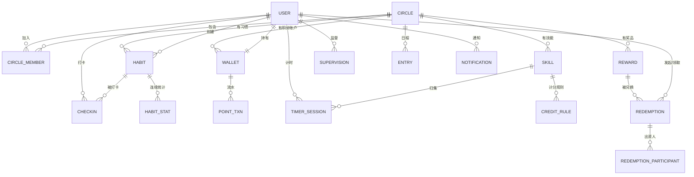

# 数据模型设计

> 对应代码：[`prisma/schema.prisma`](../prisma/schema.prisma) · 需求来源：[`PRD.md`](./PRD.md) v0.3
> 数据库：PostgreSQL · ORM：Prisma

## 0. 五条设计原则

| 原则 | 具体做法 | 为什么 |
| --- | --- | --- |
| **日期用字符串存** | `Checkin.localDate = "2026-10-20"`（已按 `dayStartHour` 折算） | 跨时区/夏令时/日切时间，用 Date 存必然出错；字符串比较、唯一约束都更直观 |
| **账本只追加** | `PointTxn` 只有 `create`，没有 `update`；退款写反向分录 | 任何"余额对不上"都能查出是哪条流水；改余额 = 新增一条 |
| **余额是冗余** | `Wallet.balance` 可以用 `sum(PointTxn.delta)` 重算 | 读取快，且随时能对账 |
| **合兑=多付款人** | `Redemption` + `RedemptionParticipant`，单人兑换就是 participants 只有一条 | 不写第二套兑换流程，状态机/退款逻辑完全复用 |
| **归档优先于删除** | `status=ARCHIVED` + `archivedAt`；有引用就禁止硬删 | 历史订单/统计不会变成孤儿数据 |

## 1. 实体关系（MVP 核心）



## 2. 表清单

### 2.1 账号与圈子

| 表 | 关键字段 | 说明 |
| --- | --- | --- |
| `User` | email, passwordHash, timezone, **dayStartHour**, weekStart | 日切时间：4 表示凌晨 4 点前算前一天 |
| `Circle` | inviteCode, ownerId, **settings(Json)** | 圈子是积分/奖品/技能的作用域 |
| `CircleMember` | role, status | 唯一约束 `(circleId, userId)`；退出后 status=LEFT 保留 |
| `Supervision` | supervisorId, memberId, habitId? | habitId 为空 = 监督全部习惯 |

**`Circle.settings` 结构**（JSON，避免为每个开关加列）：
```json
{
  "allowBackfillDays": 0,
  "backfillMonthlyLimit": 3,
  "dailyEarnCap": null,
  "milestoneBonus": { "7": 20, "30": 100, "100": 500 },
  "selfRedemptionAutoApprove": true
}
```

### 2.2 习惯与打卡

| 表 | 关键字段 | 说明 |
| --- | --- | --- |
| `Habit` | type, goalType, **frequency(Json)**, pointsPerCheckin, dailyCap | 频率规则见下 |
| `HabitStat` | currentStreak, bestStreak, lastDoneDate | 冗余，可随时由 Checkin 重算 |
| `Checkin` | localDate, seq, quantity, status, source, pointsAwarded | 唯一约束 `(habitId, userId, localDate, seq)` |

**`frequency` 的 5 种形态**：
```json
{"kind":"daily"}
{"kind":"weekdays","days":[1,3,5]}
{"kind":"perWeek","times":3}
{"kind":"interval","every":2,"anchor":"2026-10-01"}
{"kind":"monthly","times":4}
```

**为什么 `Checkin` 要存 `pointsAwarded`**：规则改了以后，历史记录的分值不能跟着变。这是"快照"原则，和订单快照同理。

### 2.3 积分

| 表 | 关键字段 | 说明 |
| --- | --- | --- |
| `Wallet` | balance, totalEarned, totalSpent | 唯一约束 `(circleId, userId)` |
| `PointTxn` | type, delta, **balanceBefore/After**, refType/refId, **idempotencyKey**, reversalOfId | 只追加 |

**扣分的原子写法**（不依赖先读后写）：
```sql
UPDATE "Wallet" SET balance = balance - $1, totalSpent = totalSpent + $1
WHERE id = $2 AND balance >= $1;
-- 影响行数 0 → 余额不足，回滚
```

### 2.4 奖品与兑换（含合兑）

| 表 | 关键字段 | 说明 |
| --- | --- | --- |
| `Reward` | pointsCost, stock(null=无限), limitPerUser, cooldownDays, needApproval, status | 定价完全由用户填 |
| `Redemption` | type(SINGLE/GROUP), status, **snapshot(Json)**, raisedPoints, expiresAt | 一张订单多个出资人 |
| `RedemptionParticipant` | userId, points, status | 合兑的出资明细 |
| `RewardQuota` | rewardId, userId, periodKey, usedCount | 限兑额度的原子占位 |

**兑换单状态**：`OPEN → APPROVED → FULFILLED → COMPLETED`，旁路 `CANCELLED/REFUNDED/EXPIRED/REJECTED`。

**合兑 = 状态 OPEN 的兑换单**：
- 发起时创建 `Redemption(type=GROUP, status=OPEN)` + 一条 `Participant`（发起人），并**预占库存**。
- 其他人加入 = 新增一条 `Participant` + 扣分。
- `raisedPoints >= pointsCost` → 事务内改 `APPROVED`，预占转正式占用。
- 过期 → `EXPIRED`，每个 `Participant` 生成反向流水退分。

### 2.5 计时与技能

| 表 | 关键字段 | 说明 |
| --- | --- | --- |
| `TimerSession` | mode, status, startedAt, **elapsedSeconds 由服务端算**, skillId, habitId, verified | 前端只上报"暂停/结束"这些事件 |
| `Skill` | name, levels(Json), **totalSeconds 冗余** | 可重算 |
| `CreditRule` | mode(TIER/PER_MINUTE/PER_SESSION), tiers(Json), minMinutes, capPerSession | 计分规则，零预置 |

**计时状态**：`RUNNING ⇄ PAUSED → COMPLETED | ABANDONED`。
净时长 = `now - startedAt - pausedTotalSeconds`，服务端算，不信前端。

**阶梯计分**：
```json
{"mode":"TIER","tiers":[{"minutes":25,"points":10},{"minutes":45,"points":20}],"minMinutes":1}
```
取满足条件的最高档；`elapsed < minMinutes` 记 0 分。

### 2.6 其它

| 表 | 用途 | 阶段 |
| --- | --- | --- |
| `Entry` | 日程（rrule 字符串、预估/实际时长） | V1.1，字段先留 |
| `Room` / `RoomMember` | 自习室 | V1.1 |
| `Notification` | 站内通知 | MVP |
| `AuditLog` | 敏感操作留痕（调分、归档、删除） | MVP |

## 3. 索引与查询

| 查询 | 用的索引 |
| --- | --- |
| 今日清单：某圈某人某天要做什么 | `Habit(circleId, status)` + `HabitStat(habitId, userId)` |
| 打卡日历：某人某月的记录 | `Checkin(userId, localDate)` |
| 积分流水 | `PointTxn(walletId, createdAt)` |
| 商城列表 | `Reward(circleId, status)` |
| 兑换记录 | `Redemption(circleId, status)`、`Redemption(initiatorId)` |
| 技能时长统计 | `TimerSession(skillId, startedAt)` |

## 4. 数据一致性守则

1. **所有涉及积分的写操作必须在事务里**，且顺序固定：校验 → 条件更新余额 → 写流水 → 写业务记录。
2. **金额/分数只用整数**，不用浮点。
3. **每个写接口带 `idempotencyKey`**（前端生成 uuid），防连点与重试。
4. **每日 02:00 对账**：`Wallet.balance == sum(PointTxn.delta)`，不一致写 `AuditLog` 并告警。
5. **删除策略**：`Habit` / `Skill` / `Reward` 有引用时只能归档；`Checkin` 当日可删（生成反向流水），历史不可删。

## 5. 迁移策略

- 用 `prisma migrate dev` 生成版本化迁移，**禁止 `db push` 直接改生产库**。
- 种子数据脚本 `prisma/seed.ts`：一个 demo 用户 + 一个圈子 + 3 个习惯 + 2 个奖品 + 3 个技能，方便本地调 UI。

## 6. 待确认（开发前需要你点头）

1. 圈子只支持**一个人一个圈**（当前 2 人场景），还是允许多圈？—— 我按"可多圈、默认 1 个"实现了，UI 先不暴露切换。
2. `Circle.settings` 里那些开关（补卡上限、每日上限、里程碑奖励）MVP 是**只存不用**还是**真做进 UI**？—— 建议先存、只开放"里程碑奖励"。
3. 负向习惯的日终结算时间：默认**次日 00:30**（按 `dayStartHour` 偏移），可接受吗？
